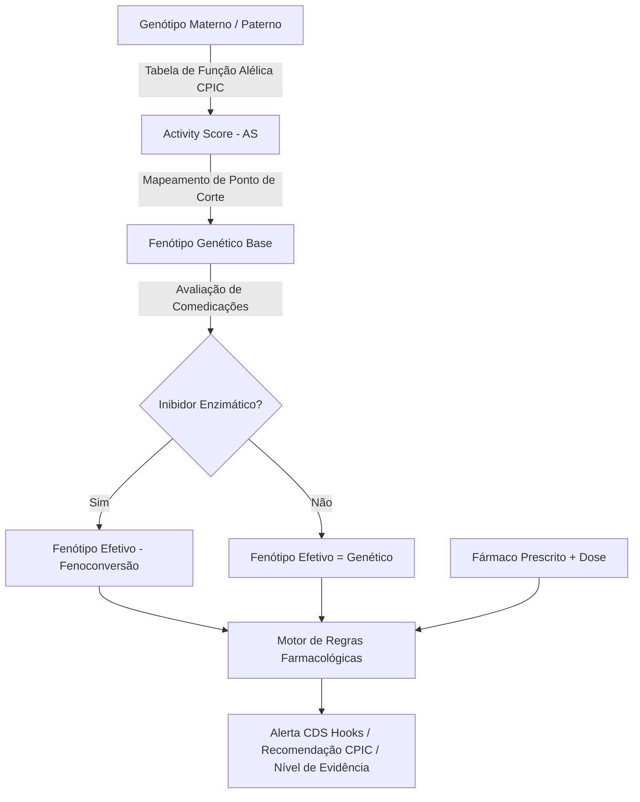

# Especificação de Lógica Clínica: Motor Farmacogenômico ClinPGx / CPIC (LOGIC.md)

Este documento descreve a máquina de estados, regras bioinformáticas e matrizes de decisão clínica do motor de apoio à decisão farmacogenômica (CDSS) prototipado em [`prototype-clinpgx.html`](file:///C:/Users/merca/REA-Laboratorio/clinpgx/prototipo/prototype-clinpgx.html).

---

## 1. Pergunta Central do Protótipo

> *"O modelo ontológico e algorítmico do CPIC / ClinPGx (baseado no Escore de Atividade de Gaedigk et al., resolução diplotípica e regras de fenoconversão) resolve com precisão e segurança os casos limítrofes da prática clínica, alertando o médico prescritor de forma inequívoca sobre riscos de ineficácia terapêutica ou toxicidade fatal?"*

---

## 2. A Tríade da Inferência Farmacogenômica

A computação segue estritamente o pipeline canônico padronizado pelo consórcio CPIC e catalogado no ClinPGx:

---

## 3. Matrizes de Valores Alélicos e Escores (Gaedigk et al.)

### 3.1. Gene CYP2D6 (`PA128`)
* **Alelos de Função Normal (Valor = 1.0):** `*1`, `*2`, `*35`, `*2A`
* **Alelos de Função Reduzida (Valor = 0.5):** `*9`, `*17`, `*29`, `*41`
* **Alelos de Função Reduzida Severa (Valor = 0.25):** `*10`, `*49`
* **Alelos Nulos / Sem Função (Valor = 0.0):** `*3`, `*4`, `*5` (deleção completa), `*6`, `*7`, `*8`, `*11`, `*15`
* **Variantes com Duplicação / Multiplicação Gênica:**
  * `*1x2` / `*2x2` = $1.0 \times 2 = 2.0$
  * `*1x≥3` = $1.0 \times 3 = 3.0$
  * `*4x2` = $0.0 \times 2 = 0.0$

$$\text{Activity Score (CYP2D6)} = \text{Score}(\text{Alelo}_1) + \text{Score}(\text{Alelo}_2)$$

* **Cortes de Fenótipo (CYP2D6):**
  * $\text{AS} = 0.0 \implies$ **Poor Metabolizer (PM)** (Metabolizador Lento/Pobre)
  * $0.25 \le \text{AS} \le 1.0 \implies$ **Intermediate Metabolizer (IM)** (Metabolizador Intermediário)
  * $1.25 \le \text{AS} \le 2.25 \implies$ **Normal Metabolizer (NM)** (Metabolizador Normal)
  * $\text{AS} > 2.25 \implies$ **Ultrarapid Metabolizer (UM)** (Metabolizador Ultrarrápido)

---

### 3.2. Gene CYP2C19 (`PA124`)
* **Alelo de Ganho de Função (Aumento de Expressão):** `*17`
* **Alelo de Função Normal:** `*1`
* **Alelos Sem Função / Nulos:** `*2`, `*3`, `*4`, `*5`, `*6`, `*7`, `*8`
* **Cortes de Fenótipo (CYP2C19):**
  * `*17/*17` $\implies$ **Ultrarapid Metabolizer (UM)**
  * `*1/*17` $\implies$ **Rapid Metabolizer (RM)**
  * `*1/*1` $\implies$ **Normal Metabolizer (NM)**
  * `*1/*2`, `*1/*3`, `*2/*17` $\implies$ **Intermediate Metabolizer (IM)**
  * `*2/*2`, `*2/*3`, `*3/*3` $\implies$ **Poor Metabolizer (PM)**

---

### 3.3. Gene SLCO1B1 (`PA134`) — Transportador Hepático de Estatinas
* **Alelo de Função Normal:** `*1` (ou `*1A`, `*1B`)
* **Alelos de Função Diminuída:** `*5` (rs4149056 c.521T>C), `*15`, `*17`
* **Fenótipos de Transporte:**
  * `*1/*1` $\implies$ **Normal Function (NF)**
  * `*1/*5` $\implies$ **Decreased Function (DF - Intermediário)**
  * `*5/*5` $\implies$ **Poor Function (PF - Baixa Função)**

---

### 3.4. Gene DPYD (`PA145`) — Di-hidropirimidina Desidrogenase
* **Alelos de Função Normal (Score = 1.0):** `*1`
* **Alelos Sem Função (Score = 0.0):** `*2A` (c.1905+1G>A), `*13` (c.1679T>G), `rs67376798` (c.2846A>T = 0.5)
* **Cortes de Fenótipo (DPYD):**
  * $\text{Score} = 2.0 \implies$ **Normal Metabolizer (NM)**
  * $1.0 \le \text{Score} < 2.0 \implies$ **Intermediate Metabolizer (IM)**
  * $\text{Score} < 1.0 \implies$ **Poor Metabolizer (PM)**

---

## 4. O Fenômeno da Fenoconversão Farmacológica

Pacientes podem ser geneticamente **Normal Metabolizers (NM)**, mas apresentar clínica de **Poor Metabolizer (PM)** devido ao bloqueio competitivo do citocromo por co-medicações:

* **Inibidores Fortes de CYP2D6:** Fluoxetina, Paroxetina, Bupropiona, Quinidina.
  * Regra: Se paciente possui $\ge 1$ alelo funcional de CYP2D6 e está em uso de Fluoxetina ou Paroxetina, seu fenótipo efetivo converte-se para **Poor Metabolizer (PM)**.
* **Inibidores Moderados de CYP2D6:** Duloxetina, Sertralina.
  * Regra: Subtrai 1.0 do Activity Score efetivo (NM $\to$ IM).

---

## 5. Matriz de Decisão Clínica (CPIC Guidelines & FDA Black Box)

| Fármaco | Gene | Fenótipo Efetivo | Gravidade do Alerta | Ação Clínica Obrigatória (CPIC Guideline) |
| :--- | :--- | :--- | :--- | :--- |
| **Codeína** | CYP2D6 | **Ultrarapid (UM)** | 🚨 **CONTRAINDICAÇÃO CRÍTICA (TÓXICA)** | **Evitar codeína.** Alto risco de toxicidade por morfina com depressão respiratória potencialmente fatal. Prescrever analgésico não-opioide ou não-CYP2D6 (ex: Morfina em dose titulada, Hidromorfona). |
| **Codeína** | CYP2D6 | **Poor (PM)** | ⚠️ **FALHA TERAPÊUTICA (INEFICAZ)** | **Evitar codeína.** Ausência de conversão em morfina ativa; ausência de analgesia. Prescrever fármaco alternativo não metabolizado por CYP2D6. |
| **Codeína** | CYP2D6 | **Normal (NM)** | ✅ **SEGURO / COMPATÍVEL** | Uso padrão conforme bula e idade/peso. |
| **Clopidogrel** | CYP2C19 | **Intermediate (IM)** ou **Poor (PM)** | 🚨 **RISCO CARDIOVASCULAR GRAVE** | **Evitar clopidogrel.** Bioativação insuficiente de metabólito ativo; risco elevado de trombose de stent e novo AVC/IAM. Prescrever Prasugrel ou Ticagrelor (salvo contraindicações). |
| **Sinvastatina** | SLCO1B1 | **Poor Function (PF)** | 🚨 **ALERTA DE MIOPATIA / RABDOMIÓLISE** | **Evitar doses de sinvastatina $\ge 20$ mg/dia ou prescrever estatina alternativa** (ex: Pravastatina ou Rosuvastatina em dose baixa) devido ao acúmulo plasmático. |
| **5-Fluorouracil (5-FU)** | DPYD | **Poor (PM)** | 🛑 **CONTRAINDICAÇÃO ABSOLUTA** | **Contraindicação estrita ao 5-FU ou Capecitabina.** Risco iminente de toxicidade precoce severa com mielossupressão letal. Utilizar regime quimioterápico não-fluoropirimidina. |

---

## 6. Cenários Guiados Pré-configurados no Protótipo

1. **Cenário 1: Analgesia & Codeína no Paciente CYP2D6 *4/*4 (PM)**
   * Mostra como a falta de teste farmacogenômico resulta em queixa de dor não controlada e suspeita indevida de simulação.
2. **Cenário 2: Risco Fatal em Recém-nascido / Amamentação (CYP2D6 *1/*1x2 - UM)**
   * Mostra o perigo clássico de óbito neonatal por intoxicação por morfina no leite materno.
3. **Cenário 3: Angioplastia com Stent & Clopidogrel (CYP2C19 *1/*2 - IM)**
   * Demonstra o desfecho tromboembólico prevenível com a troca imediata para Ticagrelor.
4. **Cenário 4: Quimioterapia de Câncer Colorretal & 5-FU (DPYD *1/*2A - IM)**
   * Demonstra o ajuste obrigatório de dose (redução de 50%) para salvar o paciente de neutropenia grau 4.
5. **Cenário 5: Fenoconversão Farmacológica (CYP2D6 *1/*1 + Fluoxetina)**
   * Demonstra que a genética pura diz "Normal", mas a interação medicamentosa converte em "Lento", gerando alerta oculto.
